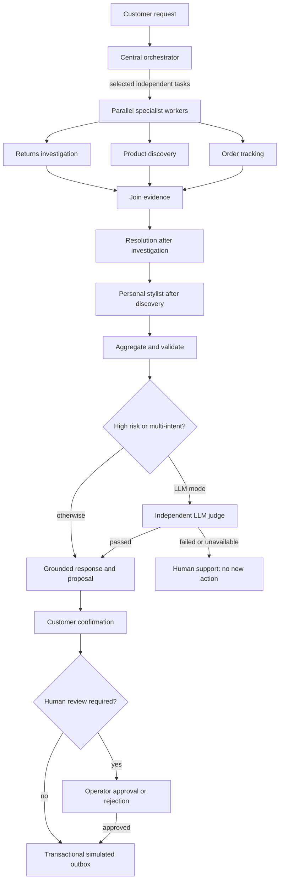

# Atlas CustomerAI

A six-agent customer concierge for **Atlas Fashion Group**, built for the Saegus AI Engineer case study. It combines return resolution, order tracking, product discovery and personal styling in one auditable customer conversation.

**Implemented:** six business agents, LangGraph conditional routing and parallel evidence workers, native LLM function calls, model-driven resolution/styling decisions, SQL, semantic policy and product retrieval with Chroma, persistent agent memory, authenticated FastAPI and web UI, human approval, an API adapter, LLM-as-a-Judge, usage/cost traces, evaluation and Docker packaging.

**Execution modes:** `demo` uses deterministic business decisions and defaults to offline lexical retrieval; `llm` uses a real model for routing, native specialist tool selection, resolution/styling decisions, grounded replies and selective separate judging. Demo outputs must not be presented as evidence of model quality. Payments and the included carrier are explicitly simulated.

## What is real, simulated and verified

| Status | Scope |
|---|---|
| Implemented software | Six distinct roles; conditional/parallel LangGraph; SQL ownership, stock and money checks; real provider tool selection and decisions; semantic policy/catalog search; persistent session/agent memory; customer/operator approval and audit |
| Simulated business systems | Entire customer/catalog/order dataset and policies; included carrier/cache; outbox payments and warehouse-inspection approval scenario. No real refund, shipment or warehouse integration |
| Verified locally | See [recorded validation](docs/VALIDATION.md) and committed JSON reports for exact tests, model runs, failures, retrieval scores, tokens and timings. Deterministic results establish software behavior; they do not establish LLM quality |
| Proposed production work | SSO/RBAC, durable graph checkpoints, distributed locking, migrations, managed vector storage, real connectors, held-out evaluation and load testing. No production ROI or SLA is claimed |

## Run locally

Python 3.12+:

```bash
python -m venv .venv
source .venv/bin/activate
pip install -r requirements.lock
pip install -e '.[dev]'
cp .env.example .env
# Set a unique ADMIN_API_KEY in .env to enable the Operations screen.
python -m uvicorn atlas.api:app --host 127.0.0.1 --port 8000
```

Open **http://localhost:8000**. Startup creates SQL tables, verifies and seeds the included data, and indexes the versioned policy corpus. Swagger API docs: http://localhost:8000/docs. The runtime dependency closure is pinned in `requirements.lock` and used by the Docker image. Development extras are pinned in `pyproject.toml`.

For PostgreSQL and the separate mock carrier service, set `POSTGRES_PASSWORD` and `ADMIN_API_KEY` in `.env` and run:

```bash
docker compose up --build -d
```

The Compose port binds to localhost. Put an HTTPS reverse proxy in front when deploying on a server. Keep one API process/replica with the current embedded Chroma and in-process session locks. The [deployment guide](docs/DEPLOYMENT.md) explains hosting and scaling boundaries.

[](https://render.com/deploy?repo=https://github.com/ManoochTayebi/Multi_agent_client)

The Render blueprint is optional and requires your hosting account; its persistent-disk plan may incur charges. Adding deployment configuration does not mean a public service has been deployed.

## Try the complete flow

| Account | Request | Expected result |
|---|---|---|
| C0001 | `Return order O1001` | Eligible EUR 79 proposal → customer confirms → queued simulation |
| C0001 | `Refund O1002` | EUR 249 proposal → customer confirms → operator review |
| C0001 | `Return O1003` | Outside the return window → reviewed exception |
| C0001 | `Build a smart casual outfit under EUR 150, size M` | Discovery → styling → stock and total-budget checks |
| C0001 | `Return O1001, track O1001 and build an outfit under EUR 150` | Independent evidence workers → resolution/styling → aggregation |
| C0002 | `Track O1004` | Delayed shipment, with a labeled source |
| C0001 | `Refund O1004` | No access to another customer's order |

For the human-review scenario, click **Confirm refund proposal**, open **Operations**, enter your `ADMIN_API_KEY`, load the queue and approve or reject with a reason. **Process simulated payments** drains the transactional outbox. Repeated confirmations do not generate duplicate payments. No real money moves.

## Agent architecture



All independent workers join before dependent stages; the stylist waits for discovery and may also wait for tracking. Agent timings, measured overlapping intervals, guardrail results and Judge verdicts are exposed in the UI.

The actual graph uses dynamic `Send` workers and a reducer to join evidence. The six business roles are the orchestrator, returns investigator, resolution agent, discovery agent, tracking agent and stylist; the judge is a quality gate. The resolution and stylist nodes skip when irrelevant. Native tool calls and bounded customer-facing decisions are recorded, without private chain-of-thought. Returns investigation establishes eligibility; resolution chooses the next action. Discovery finds candidates; styling chooses a compatible complete outfit. Validated input literals bind explicit budgets, sizes, categories and order IDs; traces expose corrected model values. Domain tools enforce ownership and money/stock rules independently of model output. See [architecture and trade-offs](docs/ARCHITECTURE.md).

## Data and RAG

All included data is original and synthetic: **200 customers, 120 products, 600 variants, 600 orders, 600 shipments, 60 return histories**, plus four fictional policy documents. The case brief explicitly allows fictional data. This avoids third-party licensing restrictions and gives repeatable test scenarios. It is not representative of real customer behavior.

```bash
python -m atlas.dataset  # regenerate seed 42, business clock 2026-10-26
```

`data/generated/manifest.json` records counts, provenance and SHA-256 digests. Generated data and fictional policies are CC0-1.0; code is MIT. Change seeds in a new database; do not silently overwrite an existing business database. See [data card](docs/DATA_CARD.md).

Chroma stores versioned policy chunks with source citations and digests. Offline mode uses normalized lexical hash vectors; this is **lexical vector retrieval**, not pretrained semantic understanding. Set `EMBEDDING_MODEL` to a provider-supported embedding model for semantic retrieval; a separate collection is created automatically. No model downloads are required for demo mode. Product descriptions are indexed separately; semantic relevance ranks only SQL-eligible size/stock/budget/category candidates. A diverse shortlist feeds the stylist, whose exact variant selections and total budget are validated. This is a prototype catalog search, not a trained personalization model.

## Enable real model calls

A lightweight local profile is available for Ollama. The review installed small models on the Intel development Mac; each new machine must install its own runtime/models:

```bash
ollama serve  # separate terminal, unless already running
ollama pull qwen3:1.7b
ollama pull all-minilm
ollama create atlas-local -f models/Modelfile
cp .env.local.example .env
# Set a random ADMIN_API_KEY, then start Uvicorn as above.
```

The profile uses real native function calls, structured decisions and semantic embeddings over `http://localhost:11434/v1`. It sets an 8K context, `max_tokens` and disabled optional thinking for Qwen3. See [local model setup and limits](docs/LOCAL_MODELS.md). Local provider charges are zero; CPU time and operating costs are not. Intel CPU journeys can take minutes.

For another compatible provider, configure `.env`:

```dotenv
ATLAS_MODE=llm
OPENAI_API_KEY=your-provider-key
OPENAI_MODEL=your-supported-chat-model
OPENAI_BASE_URL=https://api.openai.com/v1
EMBEDDING_MODEL=your-embedding-model
LLM_TOKEN_PARAMETER=max_completion_tokens
LLM_JSON_SCHEMA=true
```

The chat model must support native function calls and JSON schemas (or set `LLM_JSON_SCHEMA=false` for JSON-object output). Select the token parameter supported by your endpoint; Ollama uses `max_tokens`. Calls have configurable timeouts, token limits and bounded tool rounds. Routing, tool-selection, decision and synthesis failures produce visible warnings and bounded recovery. Required judge failures block proposals. Evaluation treats any fallback as a strict LLM failure even when recovery completes the software flow. A separately prompted judge using the same model has correlated error risk.

The main UI is served by FastAPI. An optional Streamlit API client is available:

```bash
pip install -e '.[ui]'
streamlit run scripts/streamlit_app.py
```

## Validate

```bash
ruff check atlas scripts tests
pytest -q
python -m scripts.evaluate --mode demo --output reports/evaluation-demo.json
# Two full journeys, repeated with real model calls:
python -m scripts.evaluate --mode llm --suite journeys --repeat 2 --output reports/evaluation-llm-journeys.json
# Full real-provider development suite (provider charges depend on configuration):
python -m scripts.evaluate --mode llm --output reports/evaluation-llm.json
```

Evaluation measures exact role routing, nonempty/empty result expectations, business correctness, full approval/payment-simulation journeys, measured worker overlap, real model stages without fallback, policy/product retrieval probes, token usage, configured chat cost and p50/p95 latency. These are smoke/integration measures, not a held-out quality benchmark or production SLA. See [evaluation protocol](docs/EVALUATION.md) and [recorded development validation](docs/VALIDATION.md).

**Current finalization:** the non-editable package import regression is fixed and tested outside the checkout. Current deterministic runs, browser rehearsals and environment limitations are recorded in [validation](docs/VALIDATION.md). Use the [step-by-step demo runbook](docs/DEMO_RUNBOOK.md) for the two journeys and real-model commands. The earlier 4/4 local-model journey report and 11/13 full-model report are historical evidence for their recorded source hashes; they do not validate this changed commit. No live model endpoint or credentials were available in the current workspace.

CI is configured to run lint, tests, deterministic evaluation and a Docker startup smoke test; inspect the workflow runs for remote results. A manually triggered release workflow publishes a container to GHCR. It does not provision hosting.

## Governance and operations

- Customer identity is bound to a bearer session, not a model-supplied customer ID. Demo sessions intentionally allow selecting fictional customers; set `DEMO_ACCESS=false` and configure `CUSTOMER_TOKENS` before using protected customer access.
- Admin endpoints require a separate key and are disabled if no key is configured.
- All financial actions are proposals until customer confirmation; exceptions and amounts over EUR 150 require human review.
- `/metrics` exposes aggregate run counts, latency sums and process-local model usage, without raw customer text. Operator audit records capture action transitions.
- `DELETE /api/session` deletes that session's messages and runs and revokes its token; financial audit records remain.
- Carrier calls use an operator-configured origin, a five-second timeout and a labeled cached fallback.
- Production requires SSO/RBAC, distributed session locking and admission control, managed vector storage, migration tooling, privacy retention jobs and a real payment adapter with provider idempotency. These are documented operationalization work, not completed integrations.

A consulting-oriented [six-slide French presentation](docs/PRESENTATION_FR.md) explains the value, responsibilities, two journeys, measured evidence and pilot path. The canonical repository is `ManoochTayebi/Multi_agent_client`. Hosting is optional for this case study.
