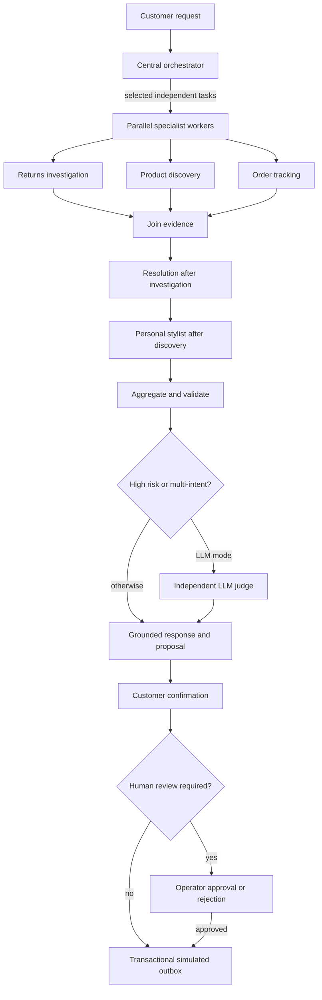

# Atlas CustomerAI

A six-agent customer concierge for **Atlas Fashion Group**, built for the Saegus AI Engineer case study. It combines return resolution, order tracking, product discovery and personal styling in one auditable customer conversation.

**Implemented:** LangGraph orchestration, authenticated FastAPI, a responsive customer and operator UI, Chroma RAG, SQL tools, persistent agent memory, human review, a carrier API adapter, reproducible synthetic data, automated evaluation, CI and Docker packaging.

**Execution modes:** `demo` runs deterministically without credentials; `llm` uses a real model for routing, specialist planning, grounded response generation and selective independent judging. Demo outputs must not be presented as evidence of model quality. Payments and the included carrier are explicitly simulated.

## Run locally

Python 3.12+:

```bash
python -m venv .venv
source .venv/bin/activate
pip install -r requirements.lock
pip install -e '.[dev]'
cp .env.example .env
# Set a unique ADMIN_API_KEY in .env to enable the Operations screen.
python -m uvicorn atlas.api:app --host 127.0.0.1 --port 8000
```

Open **http://localhost:8000**. Startup creates SQL tables, verifies and seeds the included data, and indexes the versioned policy corpus. Swagger API docs: http://localhost:8000/docs. The runtime dependency closure is pinned in `requirements.lock` and used by the Docker image. Development extras are pinned in `pyproject.toml`.

For PostgreSQL and the separate mock carrier service, set `POSTGRES_PASSWORD` and `ADMIN_API_KEY` in `.env` and run:

```bash
docker compose up --build -d
```

The Compose port binds to localhost. Put an HTTPS reverse proxy in front when deploying on a server. Keep one API process/replica with the current embedded Chroma and in-process session locks. The [deployment guide](docs/DEPLOYMENT.md) explains hosting and scaling boundaries.

[](https://render.com/deploy?repo=https://github.com/ManoochTayebi/Multi_agent_clinet)

The Render blueprint is optional and requires your hosting account; its persistent-disk plan may incur charges. Adding deployment configuration does not mean a public service has been deployed.

## Try the complete flow

| Account | Request | Expected result |
|---|---|---|
| C0001 | `Return order O1001` | Eligible EUR 79 proposal → customer confirms → queued simulation |
| C0001 | `Refund O1002` | EUR 249 proposal → customer confirms → operator review |
| C0001 | `Return O1003` | Outside the return window → reviewed exception |
| C0001 | `Build a smart casual outfit under EUR 150, size M` | Discovery → styling → stock and total-budget checks |
| C0001 | `Return O1001, track O1001 and build an outfit under EUR 150` | Independent evidence workers → resolution/styling → aggregation |
| C0002 | `Track O1004` | Delayed shipment, with a labeled source |
| C0001 | `Refund O1004` | No access to another customer's order |

For the human-review scenario, click **Confirm refund proposal**, open **Operations**, enter your `ADMIN_API_KEY`, load the queue and approve or reject with a reason. **Process simulated payments** drains the transactional outbox. Repeated confirmations do not generate duplicate payments. No real money moves.

## Agent architecture



The actual graph uses dynamic `Send` workers and a reducer to join evidence. The resolution and stylist nodes skip when irrelevant. Plans are bounded operational steps, not stored private chain-of-thought. Domain tools enforce ownership and money/stock rules independently of model output. See [architecture and trade-offs](docs/ARCHITECTURE.md).

## Data and RAG

All included data is original and synthetic: **200 customers, 120 products, 600 variants, 600 orders, 600 shipments, 60 return histories**, plus four fictional policy documents. The case brief explicitly allows fictional data. This avoids third-party licensing restrictions and gives repeatable test scenarios. It is not representative of real customer behavior.

```bash
python -m atlas.dataset  # regenerate seed 42, business clock 2026-10-26
```

`data/generated/manifest.json` records counts, provenance and SHA-256 digests. Generated data and fictional policies are CC0-1.0; code is MIT. Change seeds in a new database; do not silently overwrite an existing business database. See [data card](docs/DATA_CARD.md).

Chroma stores versioned policy chunks with source citations and digests. Offline mode uses normalized lexical hash vectors; this is **lexical vector retrieval**, not pretrained semantic understanding. Set `EMBEDDING_MODEL` to a provider-supported embedding model for semantic retrieval; a separate collection is created automatically. No model downloads are required for demo mode.

## Enable real model calls

In `.env`:

```dotenv
ATLAS_MODE=llm
OPENAI_API_KEY=your-provider-key
OPENAI_MODEL=your-supported-chat-model
# Optional OpenAI-compatible endpoint and embedding model:
OPENAI_BASE_URL=https://api.openai.com/v1
EMBEDDING_MODEL=
```

The configured chat model must support JSON object output and `max_completion_tokens`. Provider calls have timeouts and bounded retries. Routing, planning or synthesis failures are surfaced as warnings and fall back to bounded deterministic behavior. A required judge failure blocks actionable proposals and requests human support. LLM mode has not been validated with live credentials in this development environment.

The main UI is served by FastAPI. An optional Streamlit API client is available:

```bash
pip install -e '.[ui]'
streamlit run scripts/streamlit_app.py
```

## Validate

```bash
ruff check atlas scripts tests
pytest -q
python -m scripts.evaluate
# Real-provider evaluation (incurs provider usage):
python -m scripts.evaluate --mode llm --output reports/evaluation-llm.json
```

The evaluation report measures curated scenario correctness, policy recall@2, and latency. These are smoke/integration measures, not a held-out quality benchmark or production SLA. See [evaluation protocol](docs/EVALUATION.md) and [recorded development validation](docs/VALIDATION.md).

CI validates lint, tests, evaluation and a Docker startup smoke test. A manually triggered release workflow publishes a container to GHCR. It does not provision hosting.

## Governance and operations

- Customer identity is bound to a bearer session, not a model-supplied customer ID. Demo sessions intentionally allow selecting fictional customers; set `DEMO_ACCESS=false` and configure `CUSTOMER_TOKENS` before using protected customer access.
- Admin endpoints require a separate key and are disabled if no key is configured.
- All financial actions are proposals until customer confirmation; exceptions and amounts over EUR 150 require human review.
- `/metrics` exposes aggregate run counts, latency sums and process-local model usage, without raw customer text. Operator audit records capture action transitions.
- `DELETE /api/session` deletes that session's messages and runs and revokes its token; financial audit records remain.
- Carrier calls use an operator-configured origin, a five-second timeout and a labeled cached fallback.
- Production requires SSO/RBAC, distributed session locking and admission control, managed vector storage, migration tooling, privacy retention jobs and a real payment adapter with provider idempotency. These are documented operationalization work, not completed integrations.

The repository's existing name is `Multi_agent_clinet` (spelling preserved).
