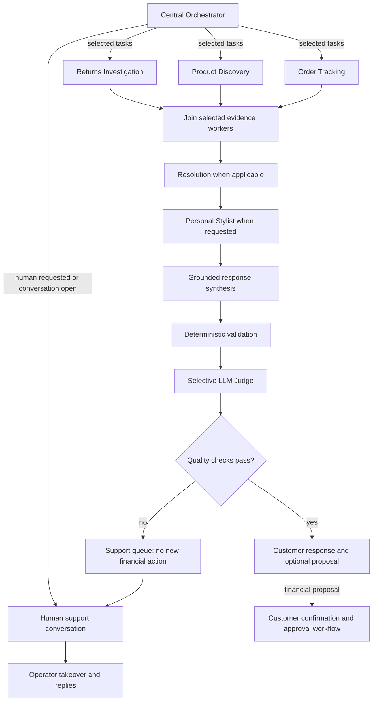

# Atlas CustomerAI

[](https://github.com/ManoochTayebi/Multi_agent_client/actions/workflows/ci.yml)

**An agentic customer-assistance platform for omnichannel fashion retail.**

Atlas CustomerAI coordinates six specialized agents to handle returns, delivery enquiries, product discovery and personal styling within a single conversation. The system combines language-model decisions with SQL-backed business facts, retrieval-augmented generation, deterministic validation and explicit approval workflows.

The reference implementation models the fictional **Atlas Fashion Group**. Customer records, product data, policies, carrier responses and financial processing are synthetic or simulated; no real payment transactions are executed.

## Capabilities

- **Context-aware orchestration:** identify the customer's goals, delegate to relevant specialists and execute independent evidence-gathering tasks in parallel.
- **Policy-grounded resolution:** investigate owned orders, retrieve applicable return policies and propose a resolution subject to customer confirmation and required human approval.
- **Direct human assistance:** let customers request a person, queue a persistent conversation and exchange messages with an operator while AI business actions are paused.
- **Product discovery and styling:** combine catalog retrieval with authoritative SQL constraints, then validate exact variants, availability, size and total outfit budget.
- **Persistent context:** retain session-specific plans and agent evidence across requests and application restarts.
- **Inspectable execution:** expose routing decisions, native tool calls, retrieval sources, timing, validation results, Judge outcomes and audit events.
- **Reproducible validation:** provide seeded datasets, isolated workflow evaluations, browser tests and container health checks in CI.

## Architecture

The six business agents are **Central Orchestrator, Returns Investigation, Resolution, Product Discovery, Order Tracking and Personal Stylist**. A separate LLM Judge is a quality gate rather than an additional business agent.



Independent evidence workers use LangGraph `Send` delegation and shared-state reducers. All selected workers join before dependent stages: Resolution consumes the investigation, and Stylist consumes Discovery results. SQL controls identity, amounts, availability and commerce constraints independently of model output.

The [architecture specification](docs/ARCHITECTURE.md) details runtime components, agent contracts, graph state, retrieval, approval transitions, persistence and failure handling.

### Technology stack

| Layer | Implementation |
|---|---|
| Orchestration | Python, LangGraph conditional routing and parallel workers |
| Model integration | OpenAI-compatible API, native function calls, Pydantic output validation |
| Business data | SQLAlchemy with SQLite or PostgreSQL |
| Retrieval | Chroma policy and catalog collections; configurable semantic embeddings |
| Application | FastAPI, customer workspace and operator interface |
| Operations | Audit trail, aggregate metrics, Docker, GitHub Actions |

## Quick start

Requires **Python 3.12+**. Run commands from the repository root. The default launch uses **deterministic `demo` mode** for reproducible software checks. To enable native LLM tool calling and semantic retrieval, use the Ollama setup below or configure a compatible provider.

```bash
git clone https://github.com/ManoochTayebi/Multi_agent_client.git
cd Multi_agent_client
python -m venv .venv
source .venv/bin/activate
pip install -r requirements.lock
pip install '.[dev]'
```

For a fresh checkout, copy `.env.example` to `.env` and replace the `ADMIN_API_KEY` placeholder with a private random value. Preserve any existing configured `.env`.

```bash
cp .env.example .env  # fresh checkout only
# Configure ADMIN_API_KEY before using the operator interface.
python -m uvicorn atlas.api:app --host 127.0.0.1 --port 8000
```

Open the [customer workspace](http://localhost:8000). The **Operations** tab uses the configured operator key. Interactive API documentation is available at [http://localhost:8000/docs](http://localhost:8000/docs), with readiness information at [http://localhost:8000/health](http://localhost:8000/health).

Startup seeds an empty database from checksum-verified fixtures and initializes the policy and product indexes. Existing business state is preserved. Keep `AS_OF_DATE=2026-10-26`, the fixed reference date for the included scenarios. The [operational runbook](docs/DEMO_RUNBOOK.md) covers fresh-state initialization, service startup and troubleshooting.

### Activate real LLM execution with Ollama

Install [Ollama](https://ollama.com/download). Keep `ollama serve` running in a separate terminal, unless the desktop application already serves port 11434. Then download the chat model and semantic encoder:

```bash
ollama pull qwen3:1.7b
ollama pull all-minilm
ollama create atlas-local -f models/Modelfile
```

In the activated Python environment, these settings override the offline defaults without overwriting an existing `.env`:

```bash
export ATLAS_MODE=llm
export OPENAI_BASE_URL=http://localhost:11434/v1
export OPENAI_API_KEY=ollama
export OPENAI_MODEL=atlas-local
export EMBEDDING_MODEL=all-minilm
export LLM_TOKEN_PARAMETER=max_tokens
export LLM_REASONING_EFFORT=none
export LLM_JSON_SCHEMA=true
python -m uvicorn atlas.api:app --host 127.0.0.1 --port 8000
```

Configure a private `ADMIN_API_KEY` as in the quick start. The `ollama` value is a local compatibility placeholder; no paid provider credential is required. [`.env.local.example`](.env.local.example) contains the same profile for a fresh local configuration.

Check `/health` for **`mode: llm`**, **`retrieval: semantic`** and **`chat_model: atlas-local`**. A completed reference journey should show `llm_route`, native `llm_tools`, model decisions and a Judge verdict in its trace, with positive `model_usage.calls` and `embedding_usage.calls`. Inspect warnings and `degraded`: an LLM-mode label alone does not prove that every stage ran without fallback. [Full setup and troubleshooting](docs/DEMO_RUNBOOK.md).

## Reference workflows

| Workflow | Customer request | Expected behavior |
|---|---|---|
| High-value refund | **C0001:** “I would like a refund for order O1002.” | Investigate the owned EUR 249 order and return policy; propose a resolution; require customer confirmation and operator review because the amount exceeds EUR 150; record simulated processing and audit events. |
| Delivery enquiry with styling | **C0001:** “Track my order O1001 and build a smart casual outfit under €150, size M.” | Run Tracking and Discovery concurrently, then compose a validated outfit. Return both delivery information and existing variants with positive stock, size M and a combined price no greater than EUR 150. |
| Direct human assistance | Any authenticated customer: “I want to speak to a real agent.” or **Talk to a person** | Bypass AI specialists, open a human conversation and show its waiting/active status. An operator takes over, reads prior context and evidence, replies and closes the conversation. |

The evidence inspector provides the execution trace and supporting records. Repeated refund requests reuse the existing action and report its lifecycle; repeated confirmations or processing do not create duplicate transactions.

### Human support

Customers can select **Talk to a person** at any point between requests, or ask for human assistance in chat. The Orchestrator routes explicit English/French requests directly, without depending on a model call. LLM routing can also recognize other phrasings. A queued request clearly says that an operator has not taken over yet.

In **Operations**, enter the operator key, select **Load support queue**, open the conversation and choose **Take over conversation**. The operator can inspect prior customer/assistant exchanges, execution reports, SQL/RAG evidence and support events before replying. Messages refresh every three seconds. While the thread is waiting or active, customer messages stay in that conversation and do not activate AI specialists.

The operator closes with a summary, or the customer selects **Return to AI concierge**. The next message can then use the six-agent pipeline again. Threads, messages and transitions survive application restarts; the browser retains its bearer session in tab-scoped session storage. Repeated requests reuse one thread per session. Session deletion removes the conversation and agent memory while preserving financial audit records.

Human conversation and financial approval remain separate permissions: takeover or a chat reply cannot confirm, approve or execute a refund. Existing proposals still require the normal explicit confirmation/review controls. A Resolution `human_support` decision or a failed quality gate also creates an operator-visible support request. Human support is provided through the built-in operator interface; no external helpdesk, telephone integration, staffing or response-time guarantee is implied.

Tracking uses a labeled cached mock record by default. To exercise the HTTP adapter, start the mock service separately and configure the main API accordingly:

```bash
python -m uvicorn atlas.mock_carrier:app --host 127.0.0.1 --port 8001
# In another terminal, start or restart the main API:
CARRIER_BASE_URL=http://127.0.0.1:8001 python -m uvicorn atlas.api:app --host 127.0.0.1 --port 8000
```

## Model configuration

| Behavior | `ATLAS_MODE=demo` | `ATLAS_MODE=llm` |
|---|---|---|
| Routing and decisions | Deterministic business baselines | Model-based routing, native specialist tool calls, resolution and styling decisions |
| Response generation | Grounded templates | Grounded model synthesis |
| Retrieval | Offline lexical vectors by default | Semantic retrieval when `EMBEDDING_MODEL` is configured |
| Judge | Not invoked | Separate model call for financial resolutions or multiple routed intents, including styling |
| Model credentials | Not required for the default offline configuration | Required for the selected compatible endpoint |

For a compatible provider, configure `.env`:

```dotenv
ATLAS_MODE=llm
OPENAI_BASE_URL=https://api.openai.com/v1
OPENAI_API_KEY=your-provider-key
OPENAI_MODEL=your-supported-chat-model
EMBEDDING_MODEL=your-supported-embedding-model
LLM_TOKEN_PARAMETER=max_completion_tokens
LLM_JSON_SCHEMA=true
```

The chat model must support native function calls and the selected JSON output format. The supplied [Ollama profile](.env.local.example) uses `atlas-local` based on Qwen3 1.7B and the `all-minilm` encoder; see [local model configuration](docs/LOCAL_MODELS.md) for installation and model-specific settings. Keep credentials outside version control.

Provider failures are surfaced through warnings and bounded fallback. A required Judge rejection or failure blocks a new actionable proposal. LLM mode can run with lexical retrieval, but strict semantic/LLM evaluation additionally requires actual embedding queries and successful model stages without deterministic fallback.

## Validation

```bash
ruff check atlas scripts tests
pytest -q
python -m scripts.evaluate --mode demo
python -m scripts.evaluate --mode demo --suite journeys --repeat 3 --output reports/workflows-demo.json
```

Optional browser validation starts isolated real HTTP services and exercises both customer and operator workflows:

```bash
pip install '.[browser]'
python -m playwright install chromium
python -m scripts.browser_demo
```

With a configured chat model and semantic encoder:

```bash
python -m scripts.evaluate --mode llm --suite journeys --repeat 3 --output reports/workflows-llm.json
```

To record the two LLM-backed customer/operator journeys in Chromium at their original speed:

```bash
python -m scripts.record_llm_demo --output reports/llm-recording.json
```

This command requires the browser extra and configured chat/embedding models. It launches isolated application/mock-carrier services, saves a WebM, screenshots and full JSON evidence, and fails if either journey lacks required model stages, native tool execution, semantic queries, guardrail/Judge approval or strict workflow checks. It does not replace model responses or remove inference waits.

Reports contain source hashes, scenario checks, execution evidence, audit events, timing, usage and fallback indicators. CI verifies non-editable package installation, tests, deterministic evaluations, Chromium workflows, Docker build and the container's actual health status. Reports and screenshots are retained as workflow artifacts.

Automated CI uses deterministic execution and controlled provider fixtures; it does not establish live-model quality. Recorded inference results apply to their documented source hashes and configuration. The [evaluation protocol](docs/EVALUATION.md) and [validation records](docs/VALIDATION.md) distinguish software checks from model-quality evidence.

### Recorded real-model verification

On **28 October 2026**, both exact reference prompts passed **3/3 repetitions each** with Qwen3 1.7B (`atlas-local`) and `all-minilm` semantic embeddings: **6/6 strict passes**, 41 model calls, zero deterministic fallback and no observed business-rule or authorization check failures. Overall request p50 was **46.3 s** and p95 **73.9 s** on the recorded CPU setup; startup/indexing is excluded.

A separate **2 min 45 s recorded walkthrough** executes both journeys through the real customer/operator UI, including confirmation, human approval and simulated completion. Its two LLM requests passed all 30 recording checks. The video preserves the original speed and inference waits; it is recorded execution, not a live session for its viewer.

[Watch the MP4](docs/media/atlas-llm-walkthrough-20261028.mp4) · [Exact-prompt JSON evidence](docs/validation/live-llm-journeys-20261028.json) · [UI evidence](docs/validation/live-ui-recording-20261028.json) · [Method, model digests and limits](docs/LIVE_VALIDATION.md)

These are disclosed development workflows, not a held-out quality benchmark or production SLA. The saved source hashes match the application modules and UI in this revision. Native model execution does not change the fictional data or simulated financial processing.

## Data and deployment

The reproducible dataset contains **200 customers, 120 products, 600 variants, 600 orders, 600 shipments and 60 return-history records**, plus four fictional policy documents. A manifest records row counts and SHA-256 digests. See the [data card](docs/DATA_CARD.md) for provenance and limitations.

The default installation uses SQLite and embedded Chroma. The existing Compose configuration provides PostgreSQL and the mock carrier:

```bash
docker compose up --build -d
```

Configure `POSTGRES_PASSWORD` and `ADMIN_API_KEY` first. [Deployment documentation](docs/DEPLOYMENT.md) describes persistence, container networking and optional hosting. The manual release workflow publishes an image to GHCR; it does not provision a hosted application.

The supported reference topology uses a **single API process/replica**. Session locking is process-local, graph supersteps are not durably checkpointed, and schema initialization uses `create_all`. Synthetic account selection is enabled by default; protected customer access requires `DEMO_ACCESS=false` and a configured credential map. Production identity, migrations, distributed coordination and real business-system integrations remain outside the implemented scope.

## Documentation and license

- [Architecture specification](docs/ARCHITECTURE.md): components, agent contracts, orchestration, data flows and safeguards.
- [Operational runbook](docs/DEMO_RUNBOOK.md): startup, workflow execution, evidence inspection and reset procedures.
- [Evaluation protocol](docs/EVALUATION.md): metrics, strict acceptance criteria and measurement limits.
- [Recorded LLM execution](docs/LIVE_VALIDATION.md): current real-model results, full-speed video, environment and source provenance.
- [Validation records](docs/VALIDATION.md): dated execution evidence and implementation reviews.
- [Data card](docs/DATA_CARD.md): synthetic dataset generation, provenance and limitations.

Code is distributed under the [MIT license](LICENSE). Generated datasets and fictional policies are dedicated under CC0-1.0.
