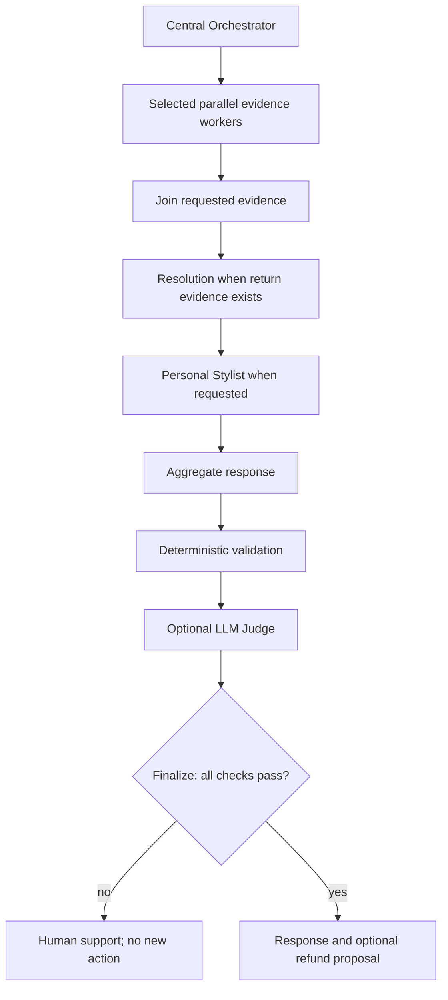

# Atlas CustomerAI

[](https://github.com/ManoochTayebi/Multi_agent_client/actions/workflows/ci.yml)

A **six-agent retail customer assistant** for the Saegus AI Engineer case study. One conversation can combine a return, shipment tracking and a personalized outfit request. Agents share verified SQL, policy and catalog evidence; financial actions remain subject to customer confirmation and human review.

**Stack:** Python · LangGraph · FastAPI · SQLAlchemy (SQLite/PostgreSQL) · Chroma · OpenAI-compatible model API · Docker.

The customer and operator interfaces run in the same FastAPI application. All business data, policies, carrier responses and payments are fictional. **No real money moves.** Public hosting is optional for this case study.

## Start here

Use Python 3.12+ and run from the repository root:

```bash
git clone https://github.com/ManoochTayebi/Multi_agent_client.git
cd Multi_agent_client
python -m venv .venv
source .venv/bin/activate
pip install -r requirements.lock
pip install '.[dev]'
```

For a fresh checkout, copy `.env.example` to `.env`. If `.env` already exists, keep it and review its configuration. Set a private random `ADMIN_API_KEY` to enable Operations; `.env` is ignored by Git.

```bash
cp .env.example .env  # fresh checkout only
# Replace the ADMIN_API_KEY placeholder in .env.
python -m uvicorn atlas.api:app --host 127.0.0.1 --port 8000
```

Open **[http://localhost:8000](http://localhost:8000)**. Startup seeds an empty database from checksum-verified fixtures and builds the policy/product indexes. Existing business state is preserved.

- Customer workspace: select **C0001** and use the Demo A/B buttons.
- Operations: enter `ADMIN_API_KEY` to inspect confirmed requests, approve/reject with a reason, inspect audit events and process simulated transactions.
- API reference: [http://localhost:8000/docs](http://localhost:8000/docs).
- Health: [http://localhost:8000/health](http://localhost:8000/health). This reports storage/index configuration, not live model quality.

Keep **`AS_OF_DATE=2026-10-26`**, the fixed synthetic business clock. Use fresh SQL/index paths between rehearsals; see the [demo runbook](docs/DEMO_RUNBOOK.md) for exact reset commands.

## Two interview demonstrations

| Demo | Customer and exact request | Expected behavior |
|---|---|---|
| A — refund with approval | **C0001:** “I would like a refund for order O1002.” | Investigation verifies the owned EUR 249 order and return policy; Resolution proposes the next step. Customer confirms → operator reviews because EUR 249 exceeds EUR 150 → simulated processing → audit. Repeated processing creates no duplicate transaction. |
| B — parallel tracking and styling | **C0001:** “Track my order O1001 and build a smart casual outfit under €150, size M.” | Tracking and Discovery overlap; Stylist consumes Discovery results. The response includes shipment status and an outfit with real synthetic variants, positive stock, size M and total price ≤ EUR 150. |

The evidence inspector shows selected roles, tool calls, actual SQL/policy/catalog results, measured start/end times, dependencies, guardrails, Judge decisions and model usage. Repeat refund requests report the existing lifecycle rather than offering a new refund. A failed validation/Judge blocks a new actionable proposal.

The default tracking source is a **labeled cached mock record**. To exercise the mock carrier over HTTP, start `python -m uvicorn atlas.mock_carrier:app --host 127.0.0.1 --port 8001` in another terminal and restart the main API with `CARRIER_BASE_URL=http://127.0.0.1:8001`.

## Execution modes

| | `ATLAS_MODE=demo` | `ATLAS_MODE=llm` |
|---|---|---|
| Decisions | Deterministic routing, domain tools and feasible-outfit baseline | Model routing, native specialist tool calls, resolution/styling choices and grounded synthesis |
| Retrieval | Offline lexical vectors by default | Semantic policy/catalog retrieval when `EMBEDDING_MODEL` is configured |
| Judge | Not invoked; clearly labeled | Separate model call for financial proposals and multiple routed intents (including styling) |
| Credentials | None for model inference | Configured chat model/key and a compatible endpoint |
| Validation meaning | Software workflow correctness | Strict model acceptance additionally requires semantic queries, relevant model stages and no fallback |

LLM mode supports optional lexical retrieval, but that configuration does **not** qualify as strict semantic/LLM evaluation. Provider failures produce visible warnings and bounded fallback; a required Judge failure blocks action. The Judge uses the same configured model in a separate call and can share the generator's errors.

For local inference, install Ollama, then:

```bash
ollama serve  # separate terminal; skip if Ollama is already serving
ollama pull qwen3:1.7b
ollama pull all-minilm
ollama create atlas-local -f models/Modelfile
```

Use `.env.local.example` as a configuration reference. It specifies `ATLAS_MODE=llm`, `OPENAI_BASE_URL=http://localhost:11434/v1`, `OPENAI_API_KEY=ollama`, `OPENAI_MODEL=atlas-local`, `EMBEDDING_MODEL=all-minilm`, `LLM_TOKEN_PARAMETER=max_tokens` and model-specific reasoning/schema settings. Retain your operator key and rehearsal paths when changing profiles. For another compatible provider, set its endpoint, actual credentials and supported chat/embedding models. See [local model setup](docs/LOCAL_MODELS.md) and the [runbook](docs/DEMO_RUNBOOK.md).

## Architecture

The six business roles are **Central Orchestrator, Returns Investigation, Resolution, Product Discovery, Order Tracking and Personal Stylist**. The Judge is a quality gate, not another business agent.



The worker pool contains Returns Investigation, Product Discovery and Order Tracking. Conditional routing selects only relevant roles. All selected workers join before downstream stages; Stylist therefore waits for Discovery and may also wait for Tracking. SQL rules own customer identity, money, variants, stock and budget. [Architecture details and approval state machine →](docs/ARCHITECTURE.md)

## Verify and inspect results

```bash
ruff check atlas scripts tests
pytest -q
python -m scripts.evaluate --mode demo
python -m scripts.evaluate --mode demo --suite journeys --repeat 3 --output reports/demo-journeys.json
```

Browser rehearsal (starts isolated real HTTP services, exercises both UIs, then stops them):

```bash
pip install '.[browser]'
python -m playwright install chromium
python -m scripts.browser_demo
```

Real-model rehearsal, after configuring a working provider and semantic encoder:

```bash
python -m scripts.evaluate --mode llm --suite journeys --repeat 3 --output reports/llm-journeys.json
```

Reports contain actual source hashes, evidence, audit events, role/timing checks, usage and fallback indicators. CI installs non-editably, verifies package imports outside the checkout, runs tests/API evaluations/Chromium rehearsals, builds Docker and requires the container's health status to become `healthy`. CI uploads reports and screenshots as artifacts. The manual release workflow publishes an image to GHCR; it does not provision hosting.

See the [current review](docs/REVIEW.md) and [validation history](docs/VALIDATION.md). Historical model reports apply only to their recorded source hashes. Deterministic test passes and controlled provider fixtures do not establish current live-model accuracy. No production readiness, business ROI or service-level performance is claimed.

## Data, persistence and boundaries

The reproducible seed includes **200 customers, 120 products, 600 variants, 600 orders, 600 shipments, 60 return histories**, plus four fictional policies. `data/generated/manifest.json` records counts and SHA-256 digests. Regenerate with `python -m atlas.dataset`; use a fresh database/index for a new dataset. Generated data/policies are CC0-1.0; code is MIT. [Data card →](docs/DATA_CARD.md)

SQL stores business facts, session/agent memory, run evidence, proposals, audit and the transactional simulation outbox. Chroma stores versioned policy and catalog vectors. Customer bearer tokens bind ownership; admin routes require a separate key. `DEMO_ACCESS=true` intentionally permits selection of fictional accounts. Protected mode requires `DEMO_ACCESS=false` and configured `CUSTOMER_TOKENS`.

Session deletion removes messages/runs and revokes the token; financial audit remains. Deletion during an active chat returns 409 so the request cannot recreate deleted memory. Use one API process/replica; graph steps are not durably checkpointed, session locks are process-local and schema setup uses `create_all` rather than versioned migrations.

For PostgreSQL plus the existing mock carrier, configure `.env` and run `docker compose up --build -d`. [Deployment instructions](docs/DEPLOYMENT.md) cover volumes, Ollama container networking and optional Render hosting. An optional Streamlit chat client is included; the FastAPI web UI is the complete customer/operator demonstration interface.

## Documentation

| Document | Purpose |
|---|---|
| [Demo runbook](docs/DEMO_RUNBOOK.md) | Launch, exact prompts, approvals, traces, resets and troubleshooting |
| [Architecture](docs/ARCHITECTURE.md) | Six roles, graph dependencies, retrieval, trust boundaries and action lifecycle |
| [Current review](docs/REVIEW.md) | Latest fixes, checks and unresolved limitations |
| [Evaluation protocol](docs/EVALUATION.md) | Metrics, strict model acceptance and independent-evaluation limits |
| [French presentation outline](docs/PRESENTATION_FR.md) | Six-slide business and technical story for the interview |
