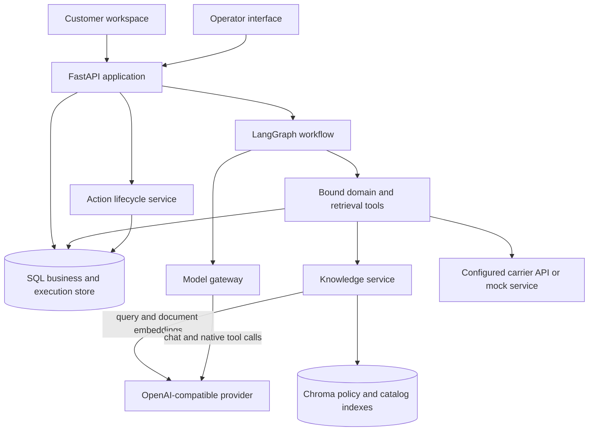
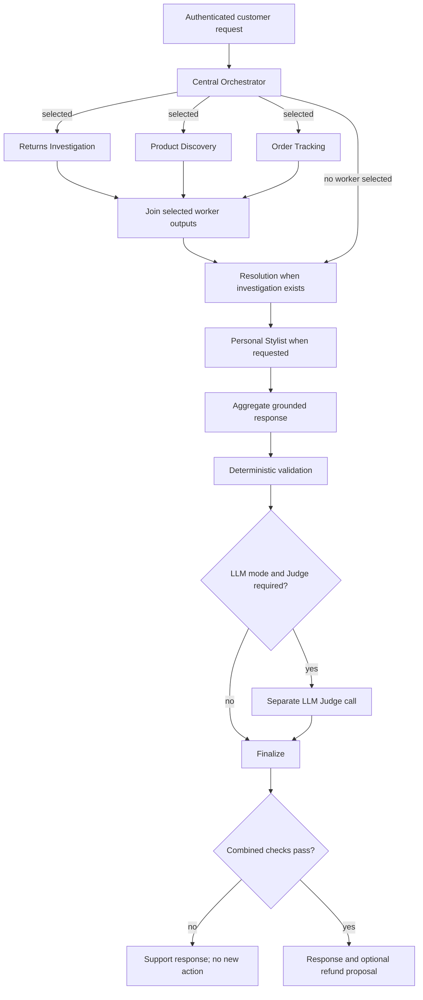
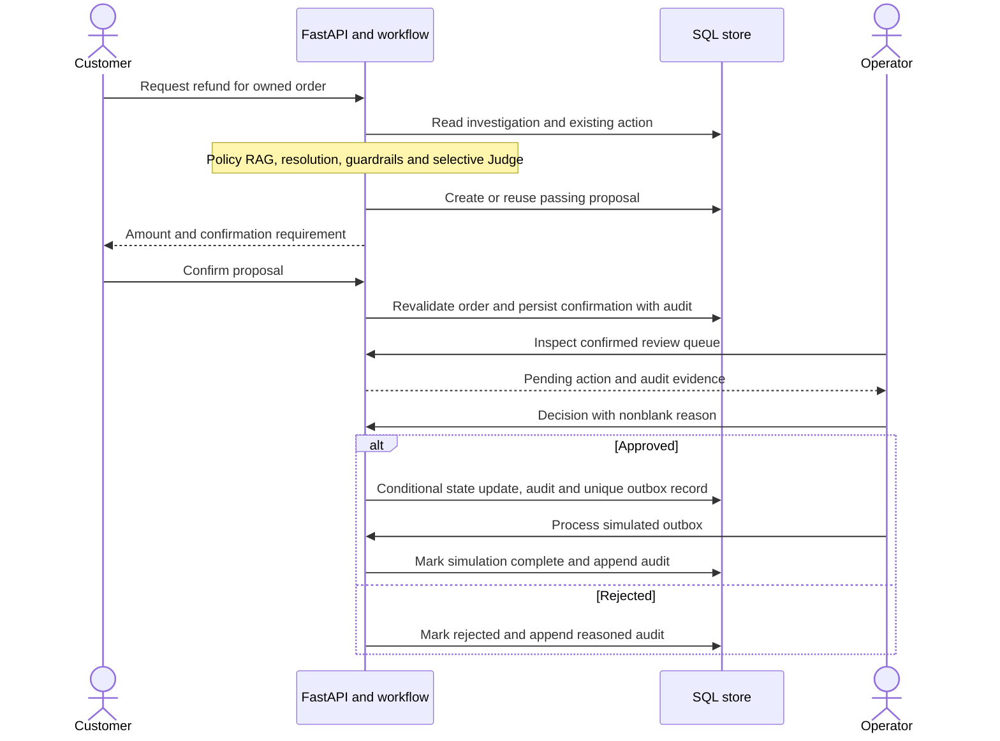

# Architecture specification

## 1. Purpose and design principles

Atlas CustomerAI coordinates customer service and product advice for a fictional omnichannel fashion retailer. It supports requests that span returns, delivery enquiries and styling while keeping transactional facts and financial permissions outside model control.

The implementation uses six business agents within one Python application. Its main design choices are:

- **Explicit delegation:** LangGraph selects relevant specialists, executes independent tasks concurrently and preserves dependencies between investigation/resolution and discovery/styling.
- **Authoritative business tools:** parameterized SQL and application rules determine ownership, amounts, stock, size, eligibility and approval requirements.
- **Grounded model decisions:** language models select bounded tools, choose among verified options and synthesize replies from retrieved evidence.
- **Separated quality and authorization:** deterministic validation and a selective model Judge assess a response; customer confirmation and operator approval separately authorize financial state transitions.
- **Persistent evidence:** SQL records agent context, run outputs, action transitions and audit history. Reproducible synthetic fixtures support isolated verification.

All customer/catalog/order data and policies are fictional. Carrier responses, warehouse-inspection scenarios and financial processing are simulated. The implementation does not connect to a real payment provider.

## 2. Runtime components

The customer/operator pages are served by the same FastAPI application. The action lifecycle and simulation drain are application components, not separate background services. The optional mock carrier runs as an auxiliary HTTP service. A configured model endpoint can be local Ollama or another compatible provider.

| Component | Source | Responsibility |
|---|---|---|
| API and UI | [`atlas/api.py`](../atlas/api.py), [`atlas/static/index.html`](../atlas/static/index.html) | Sessions, authentication, admission control, customer chat, operator decisions, audit and metrics |
| Workflow | [`atlas/agents.py`](../atlas/agents.py) | Graph construction, routing, role execution, aggregation and quality gates |
| Specialist tool registry | [`atlas/specialists.py`](../atlas/specialists.py) | Role-scoped function schemas, server-bound callbacks and outfit feasibility rules |
| Domain tools | [`atlas/tools.py`](../atlas/tools.py) | Owned SQL lookups, eligibility investigation, catalog filtering, current-variant validation, shipment adapter and agent memory |
| Model gateway | [`atlas/model.py`](../atlas/model.py) | Structured responses, bounded native tool loops, provider settings and per-run usage attribution |
| Knowledge service | [`atlas/retrieval.py`](../atlas/retrieval.py) | Policy/catalog indexing, embedding calls, vector retrieval and provenance |
| Financial lifecycle | [`atlas/actions.py`](../atlas/actions.py) | Proposal uniqueness, confirmation, human decisions, transactional outbox and simulated completion |
| Persistence | [`atlas/db.py`](../atlas/db.py) | SQLAlchemy tables, connections, constraints and SQLite configuration |
| Contracts/configuration | [`atlas/schemas.py`](../atlas/schemas.py), [`atlas/config.py`](../atlas/config.py) | Typed request/model outputs and environment configuration |
| Fixtures and evaluation | [`atlas/dataset.py`](../atlas/dataset.py), [`scripts/evaluate.py`](../scripts/evaluate.py) | Reproducible data and isolated scenario measurements |

## 3. Business-agent contracts

| Agent | Decision or responsibility | Tools and evidence | Output and memory |
|---|---|---|---|
| **Central Orchestrator** | Identify current goals, select specialists and carry forward a clear same-session order reference | Current request; previous routing plans; typed `Plan` output | Intent plan, order reference, budget/size/category/language constraints and routing rationale; prior plans persisted under `orchestrator` |
| **Returns Investigation** | Establish return eligibility and required review signals | `investigate` reads the owned order, recorded condition, return history and existing refund lifecycle; `policy_search` retrieves cited policy | Verified investigation and policy evidence; prior investigation findings |
| **Resolution** | Select `standard_refund`, `review_exception` or `human_support` | Investigation, policy excerpts, prior resolutions; typed `ResolutionDecision` | Reason, proposed next steps and authoritative amount/review state; cannot set money or waive mandatory review |
| **Product Discovery** | Find relevant candidates within authoritative commerce constraints | `product_search` combines SQL filters with Chroma ranking; `policy_search` retrieves applicable guidance | SQL product/variant records, retrieval distances, size, candidate count and retrieval mode; prior discovery findings |
| **Order Tracking** | Report the owned shipment's status and source freshness | `shipment` uses the configured carrier adapter or cache; `policy_search` retrieves shipping guidance | Verified shipment record and source label; prior tracking findings |
| **Personal Stylist** | Select complementary exact variants from Discovery's candidate set | Request, candidate variants, total budget, prior outfits; typed `OutfitDecision` | Selected variant IDs and a customer-facing reason, subject to feasibility/current-SQL validation; prior outfit decisions |

The Judge, aggregation and validation nodes are workflow infrastructure, not additional business agents. Operational plans, selected tools and customer-facing reasons are recorded; private chain-of-thought is not requested or stored as an execution artifact.

### Model decisions and deterministic authority

| Model-controlled behavior | Application-controlled boundary |
|---|---|
| Select requested intents and interpret semantic goals | Validate the plan; bind explicitly stated order ID, size, budget and category literals; ensure styling includes Discovery |
| Choose a role's native function calls and search query | Allow only that role's registered functions; bind customer/order identity and commerce filters on the server |
| Recommend the resolution path | Derive amount and eligibility from SQL; reject a model attempt to bypass required human review |
| Select outfit variants and explain relevance | Restrict candidates to retrieved SQL records; check composition, size, stock, provenance and combined price |
| Generate the customer reply | Supply verified findings and policy excerpts; apply deterministic checks and selective Judge review |
| Judge the draft's groundedness/completeness | Combine its verdict with existing checks; a model pass cannot override a deterministic failure |

## 4. Orchestration and request lifecycle

### 4.1 Graph topology

`Pipeline` constructs a `StateGraph(State)`. The Orchestrator dispatches `Send('worker', state_with_role)` tasks to one shared worker implementation; the role-specific registry supplies the specialization. Selected workers execute in the same graph superstep and append findings, traces and warnings through reducers.

All selected workers join before `resolution` and `personal_stylist`. The Stylist therefore starts after Discovery completes, but may also wait for Tracking. No claim is made that local model inference itself runs concurrently: a provider can serialize its requests even when graph workers overlap. The graph is invoked with a recursion limit of 20.

A no-task request skips workers and traverses the no-op resolution/styling stages before aggregation. Resolution skips when no owned return investigation exists; Stylist skips unless requested. Resolution is derived from investigation rather than exposed as a directly selectable routing intent.

### 4.2 Request processing

1. **Authenticate and admit.** Resolve the bearer token to a persisted customer session. Acquire its process-local lock and an available chat slot; concurrent chat/deletion conflicts return 409 and exhausted chat capacity returns 429.
2. **Plan.** Load previous same-session plans, obtain the current structured route and validate it. Trusted parsing binds explicit commerce/identity literals independently of model interpretation. An explicit empty intent list is valid; a missing `intents` field is not.
3. **Gather independent evidence.** Run the selected worker roles. In LLM mode each uses native function calls; the minimum contract requires both its domain lookup and `policy_search`. Findings are persisted in agent memory and merged into the graph state.
4. **Resolve and style.** Consume the joined evidence. Resolution chooses a permitted path. Stylist selects exact candidate IDs and can receive one bounded correction opportunity after an invalid choice. An existing refund's lifecycle is supplied as SQL evidence rather than reopening it.
5. **Synthesize.** Combine the verified findings, selected outfit/resolution and deduplicated policy excerpts into one customer reply. A deterministic evidence-derived response is available if model synthesis fails.
6. **Validate.** Check missing/failed evidence, outfit provenance/composition and total budget. Re-read selected variants from current SQL and compare product IDs, size, stock and prices. For a resolution, recheck the owned order and amount.
7. **Judge selectively.** In LLM mode, invoke a separate quality call when `bool(resolution) or len(plan.intents) > 1`. Styling alone creates Discovery and Stylist intents, so it is judged. The Judge condition does not erase earlier failures; its result is combined with deterministic validation.
8. **Finalize and persist.** Publish a support response or a passing result. Financial proposals are created/reused only when quality passes and Resolution has not selected `human_support`. Persist the completed/blocked run evidence, latency and model/embedding usage.

### 4.3 Graph-state contract

| State group | Fields | Update behavior |
|---|---|---|
| Request identity | `message`, `customer_id`, `session_id`, `run_id` | Bound at API/workflow entry; identity is not a model tool argument |
| Routing | `plan` | Typed intents, order reference, category, EUR-cent budget, size, language and rationale |
| Parallel evidence | `findings`, `trace`, `warnings` | `Annotated[list, operator.add]` reducers merge worker outputs |
| Business decisions | `resolution`, `outfit` | Written by dependent decision stages |
| Quality | `guardrails`, `quality`, `judged`, `judge_evaluation` | Preserve deterministic evidence and the separate Judge result |
| Publication | `draft_answer`, `answer`, `action` | Keep the draft, final response and optional persisted financial action |

Routing constraints use integer EUR cents, supported sizes `XS`, `S`, `M`, `L`, `XL`, and the typed category/language values defined in `atlas/schemas.py`. Resolution is derived from verified return evidence rather than accepted as a direct intent.

`Pipeline.run` additionally returns `model_usage`, `embedding_usage`, `degraded` and `execution_summary`. `degraded` reflects surfaced warnings/fallback; a Judge rejection can block a result without being a deterministic fallback. `runs.status=needs_review` records a blocked quality result; it does not automatically create an operator queue item. The operator queue contains confirmed financial actions with `actions.status=pending_review`.

## 5. Retrieval and commerce validation

### 5.1 Index initialization

Policies are read from `data/policies/*.md` and split on blank paragraphs. Each chunk retains a source name, content digest and text. Chroma upserts changed chunks and removes obsolete ones. There is no separate fixed-token chunker, overlap stage or cross-encoder reranker.

Products are read from the generated catalog. Indexed descriptions combine the name, description, style, color and factual category context. Catalog IDs and text digests support updates and removal of stale documents. These descriptions do not invent availability, price, material or fit information.

Policy and product collections are separate. Collection names include a digest of the configured embedding endpoint/model identifier, or the offline lexical encoder identifier. If model weights change behind an unchanged tag, the identifier alone does not detect that change; use a fresh index/versioned model reference when changing encoder weights.

### 5.2 Retrieval at request time

| Retrieval path | Processing | Returned evidence |
|---|---|---|
| Policy | Embed query → cosine-distance vector query → top cited chunks | Source/chunk, text, distance and SHA-256 digest |
| Product | Read profile/request constraints → SQL filter for size, positive stock, category and individual price cap → vector rank eligible IDs → retain category diversity | Authoritative SQL product/variant facts enriched with retrieval distance |

The default product shortlist has at most 24 candidates. It begins with up to eight highly ranked products, preserves category diversity and fills from the remaining ranking. This gives the Stylist enough complementary categories without making semantic similarity the authority for stock or price.

With `EMBEDDING_MODEL` configured, queries/documents use the compatible provider's embedding API. With it unset, they use stable normalized 512-dimensional lexical hash vectors. The configured encoder is not silently replaced after failure. Startup embedding errors fail initialization; request-time evidence failures are surfaced and can block publication.

### 5.3 Outfit constraints

An outfit must contain either one upper-body garment plus one lower-body garment, or one dress. Optional footwear/outerwear is allowed within the validated category and selection constraints; duplicate variants/categories and incompatible combinations are rejected. All selected items must originate from Discovery, match the requested size and fit the **combined** budget.

The deterministic baseline enumerates feasible combinations. LLM mode selects exact IDs and provides a reason. Category composition is validated in Python; style/color relevance is a model/retrieval decision rather than a deterministic guarantee of fashion quality or fit. Final SQL revalidation suppresses stale recommendations before publication.

Return-policy rules are also enforced in Python: the current implementation uses an inclusive 30-day window, recorded unworn condition, a review threshold above EUR 150 and a repeat-return review signal at three prior returns. Policy RAG supports interpretation/explanation; editing a policy document alone does not change these coded thresholds. The policy corpus, rules and regression tests must remain aligned.

## 6. Financial action lifecycle

### 6.1 State transitions

```mermaid
stateDiagram-v2
    [*] --> proposed: Passing quality gates and owned order
    proposed --> pending_review: Customer confirms; human review required
    proposed --> queued_simulation: Customer confirms; standard path
    pending_review --> queued_simulation: Operator approves with a reason
    pending_review --> rejected: Operator rejects with a reason
    queued_simulation --> completed_simulation: Authorized simulation drain
    rejected --> [*]
    completed_simulation --> [*]
```

A review signal is not a fraud finding or an automatic rejection. High-value requests and policy exceptions require human review after explicit customer confirmation. The condition/inspection information is fictional recorded data; there is no live warehouse integration.

### 6.2 High-value request sequence

Confirmation re-reads the owned order. Changed conditions or amounts force human review. Operator decisions apply only to confirmed `pending_review` actions and use the persisted proposal amount; a real financial adapter would additionally require provider reconciliation and execution-time business checks.

`actions` has a unique `(order_id, kind)` constraint. A repeat request returns the same owned action and its recorded pending/queued/rejected/completed lifecycle. `outbox.action_id` is unique. Conditional updates, audit insertion and outbox insertion/completion occur within SQL transactions, preventing repeated confirmation or draining from creating a duplicate simulated transaction.

Processing is explicit through `/admin/outbox/drain`; it is not an autonomous background payment worker. A completed simulation is never represented as a real payment. Rejected and completed actions are not reopened by another chat request.

## 7. Persistence and memory

| Data group | Tables | Relationships and behavior |
|---|---|---|
| Customer context | `customers`, `sessions` | Sessions reference a customer; only a hash of the session bearer token is stored, with a 24-hour expiry |
| Catalog | `products`, `variants` | Variants reference products and hold size/stock; product prices are integer EUR cents |
| Orders and logistics | `orders`, `shipments`, `returns` | An order references a customer and variant; shipments are unique per order; histories reference orders |
| Agent memory | `messages` | Session/agent/role-scoped JSON findings or decisions with timestamps; prompts read bounded recent context |
| Execution evidence | `runs` | Session-scoped result JSON, status, latency and timestamps |
| Financial lifecycle | `actions`, `audit`, `outbox` | Owned order actions; action-scoped audit and unique outbox records; retained independently of conversation deletion |

The generated schema models one variant line per order. `actions.run_id` is a correlation string rather than a foreign key to `runs`, allowing financial history to remain when conversational runs are deleted.

Memory is durable through SQL, not through a LangGraph checkpointer. A request has transient graph state; previously completed agent evidence is loaded on later requests and survives application restart. A crash does not resume individual supersteps. Financial uniqueness constraints protect action creation when a request is retried as a new run.

Session deletion removes that session's messages and runs, then revokes its token. It shares the chat lock and returns 409 during active processing. Existence is checked after lock acquisition to reject a session deleted after initial authentication. Financial actions/audit are retained. Prompt-context limits are not automated retention policies; a separate scheduled cleanup policy is outside the implementation.

## 8. Access control and execution bounds

Customer sessions bind every owned lookup to the authenticated customer. `DEMO_ACCESS=true` intentionally allows selecting synthetic accounts. With it disabled, session creation requires an operator-configured `CUSTOMER_TOKENS` credential map. This is a reference authentication mechanism, not enterprise identity integration.

Operator endpoints require a separate `X-Admin-Key`. Reasons are stripped of surrounding whitespace and validated before approval/rejection. A shared key identifies an operator role, not an individually authenticated employee. User text and retrieved content are treated as untrusted prompt data; financial permissions and tool schemas remain enforced outside model text.

| Boundary | Current implementation |
|---|---|
| Chat admission | At most eight concurrent chats per process; excess requests return 429 |
| Same-session mutations | Chat and deletion share a nonblocking lock; conflicts return 409. Other endpoints retain their own authorization/state checks |
| Native specialist tools | Up to three model rounds and six calls; allowlisted names and role-specific Pydantic argument schemas |
| Required evidence | Both domain and policy tools must succeed; incomplete evidence cannot count as successful specialist execution |
| Stylist correction | One additional model decision after an invalid selection; both attempts remain traceable |
| Chat gateway | Configurable timeout, output-token limit, token-parameter name, JSON format and SDK retries; defaults are 180 seconds, 800 output tokens and zero SDK retries |
| Embedding gateway | Separate compatible API calls with a 20-second timeout and one SDK retry |
| Graph invocation | Recursion limit of 20 |

These are per-stage bounds, not an end-to-end request deadline. A workflow can contain several sequential calls, and provider queueing/CPU inference can make a complete request take substantially longer than one stage. Locks/admission are process-local; the documented topology uses one API process/replica with embedded Chroma.

## 9. Failure handling and observability

| Condition | Behavior |
|---|---|
| Invalid/unavailable routing output | Visible deterministic route fallback; explicit literals remain bound |
| Invalid tool arguments | Return tool-error feedback for correction within the same bounded loop |
| Denied tools or exhausted evidence loop | Visible bounded-tool fallback; failed evidence still blocks quality validation |
| Invalid/unavailable resolution or styling decision | Retain mandatory constraints and use labeled deterministic recovery where feasible |
| SQL or configured retrieval outage | Surface missing/failed evidence; block an invalid new action |
| Carrier timeout or invalid response | Return the labeled last synchronized mock status |
| Synthesis failure | Return the evidence-derived template and record degradation |
| Required Judge rejection/unavailability | No new actionable proposal; support response and recorded quality failure |
| Unexpected workflow failure | Return 503 and persist a failed run when the database remains available; a database outage can also prevent that failure record |

`trace` records each selected business role, operational steps, execution mode, source references, tool calls and monotonic start/end times. `execution_summary.parallel_pairs` measures actual interval overlap. `guardrails` and `judge_evaluation` preserve separate outcomes. The UI presents completed execution evidence, not a streamed internal timeline.

`model_usage` and `embedding_usage` attribute events to a run across concurrent worker contexts. Chat usage includes returned prompt/completion tokens and configured cost estimates; missing rates/usage remain null. SDK-internal retries are not separate application call events. Initial index creation is excluded from contact inference usage. These estimates are not a full provider billing or infrastructure-cost ledger.

`/health` verifies SQL/index access and reports configuration; it does not perform live inference. Operator-authenticated `/metrics` provides aggregate run counts, latency sums and process-local model usage without raw customer text. Human-support wording for a failed quality check does not imply an automatically created operator case.

The Judge uses a separate prompt to the same configured model and can share its errors. Passing deterministic checks or a Judge verdict is not proof that every natural-language claim is correct. Independent annotation, adversarial evaluation and broader multilingual testing remain necessary to assess model quality.

## 10. Deployment and verification

The default runtime uses FastAPI, SQLite and embedded Chroma. Docker packages the same application as a non-root user. The existing Compose configuration adds PostgreSQL and the auxiliary mock carrier; it does not install or start Ollama. A host model endpoint must be reachable from the container. The simulated outbox remains part of the application.

CI installs `atlas` and `scripts` non-editably, validates imports outside the checkout, runs lint/tests/API evaluations/repeated workflows and executes the real Chromium customer/operator flow. A separate job builds the image, checks startup and requires Docker's actual HEALTHCHECK status to become `healthy`. The manual release workflow publishes a container image; public hosting is a separate optional deployment step.

Software checks, controlled provider fixtures and actual model inference have different evidential value. Execution reports retain configuration and source hashes; historical results apply only to their recorded implementation. See the [evaluation protocol](EVALUATION.md), [validation records](VALIDATION.md), [operational runbook](DEMO_RUNBOOK.md) and [deployment guide](DEPLOYMENT.md).

Production adoption would require versioned migrations rather than `create_all`, enterprise identity/RBAC, retention/backup policies, coordination and shared storage for multiple replicas, and authorized real business connectors. The current implementation does not claim production readiness, measured ROI, independently established model accuracy or a service-level performance guarantee.
