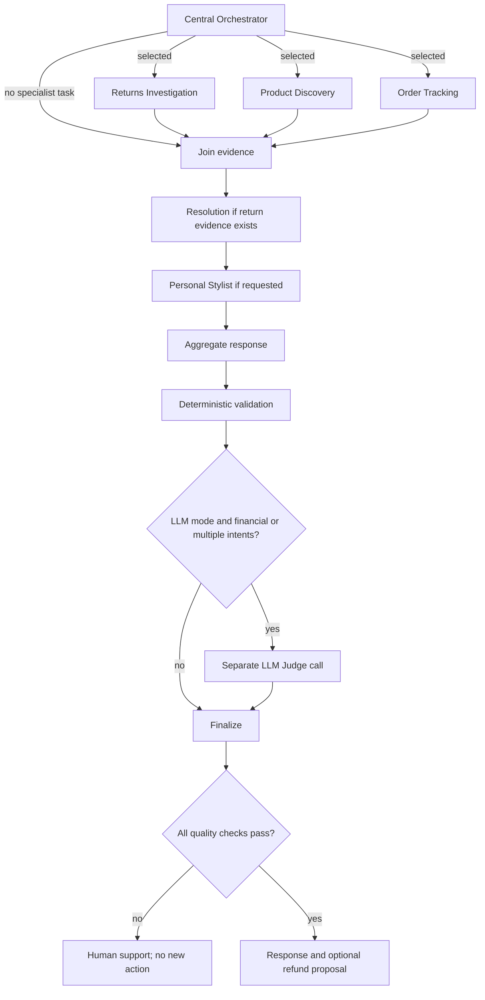

# Atlas CustomerAI architecture

Atlas combines retail service and advice in one conversation. A customer can ask for a return, shipment tracking and styling without repeating context across disconnected assistants. The implementation keeps **six business roles**, a single FastAPI application and explicit LangGraph dependencies. The data and financial/warehouse/carrier operations are fictional.

## Roles and decisions

| Business agent | Responsibility | Inputs and bounded tools | Persistent memory |
|---|---|---|---|
| Central Orchestrator | Select the requested goals and coordinate the response | Current request, previous session plan; structured model routing | Prior routing plans |
| Returns Investigation | Establish ownership, eligibility and review signals | Owned order/history/current refund state in SQL; policy RAG | Prior investigation evidence |
| Resolution | Choose the next resolution step without changing money or mandatory review | Investigation, policies; structured resolution decision | Prior resolutions |
| Product Discovery | Find relevant available candidates | SQL size/stock/price/category filters; Chroma product ranking; policy RAG | Prior discovery evidence |
| Order Tracking | Report verified delivery status and freshness | Owned SQL shipment; configured carrier API with labeled cache fallback; policy RAG | Prior shipment evidence |
| Personal Stylist | Choose compatible exact variants under the total budget | Discovery shortlist, request and prior outfit; structured variant selection | Prior outfits and customer-facing reasons |

In `llm` mode the model selects native function calls and queries within each specialist's role-specific registry. Operational decisions, tool calls and evidence are inspectable; private chain-of-thought is not requested or persisted. Resolution, styling, synthesis and judging use structured model outputs. In `demo` mode routing, tool execution and decisions use transparent deterministic baselines; no model calls or Judge verdicts are fabricated.

## Orchestration and quality gates

**Implementation mapping:** `atlas/agents.py` builds the StateGraph. The Orchestrator emits dynamic `Send` tasks to a shared `worker` node, each with a role-specific tool registry from `atlas/specialists.py`. Findings, traces and warnings use list reducers. Resolution and Stylist run after the worker superstep and skip when irrelevant; a no-task request bypasses workers and traverses those no-op stages. Judge is a quality node, not a seventh business role.

The graph joins **all selected independent workers** before downstream stages. It does not start the Stylist immediately when Discovery finishes if Tracking is still running. Trace intervals record process-monotonic start/end times; compare them only within a single run. `execution_summary.parallel_pairs` measures real worker overlap. A local model server may serialize inference even while graph workers overlap.

The Judge condition is `bool(resolution) or len(plan.intents) > 1` in LLM mode. An outfit request itself produces Discovery and Stylist intents, so it is judged even without a separate tracking/return request.

An explicit empty intent list is valid for a greeting; a missing `intents` field or malformed model response is not a valid route and triggers visible fallback. Trusted parsing binds explicit budget/size/category/order literals before tools run and records corrections of model values. Intent selection remains model-driven in LLM mode.

## SQL and RAG evidence

SQLAlchemy supports SQLite locally and PostgreSQL in the existing Compose configuration. Domain lookups use parameterized SQL and the authenticated customer ID. Models cannot submit identity, arbitrary SQL, prices, refund amounts or arbitrary API URLs as tool arguments.

Chroma keeps separate, versioned collections for policy chunks and product descriptions. Policy results include source filename/chunk, digest, text and distance. Catalog descriptions include factual category definitions; ranking is restricted to SQL-eligible IDs and keeps category diversity for complete outfits. SQL remains authoritative for prices, size and stock. Index initialization rebuilds changed documents; embedding model/endpoint changes select separate collections.

With `EMBEDDING_MODEL` unset, retrieval uses deterministic normalized lexical hash vectors. With a configured encoder it uses actual provider embeddings. This is a visible configuration choice, not silent semantic fallback. Embedding failure at startup fails initialization. Semantic relevance must be measured separately from software correctness; the development probes are not held out.

The Stylist selects exact variant IDs from Discovery. Python checks provenance, duplicate IDs, compatible categories and the total outfit budget. A second SQL lookup rechecks current product/variant IDs, size, positive stock and unchanged prices before publication. A failed check suppresses the stale recommendation. The deterministic outfit baseline searches feasible complete combinations; it does not claim to be a trained recommender.

## Refund lifecycle and authorization

```mermaid
stateDiagram-v2
    [*] --> proposed: Verified and quality-approved proposal
    proposed --> pending_review: Customer confirms; review required
    proposed --> queued_simulation: Customer confirms; standard policy path
    pending_review --> queued_simulation: Operator approves with a nonblank reason
    pending_review --> rejected: Operator rejects with a nonblank reason
    queued_simulation --> completed_simulation: Operator drains simulated outbox
    rejected --> [*]
    completed_simulation --> [*]
```

Amounts above EUR 150, policy exceptions and repeat-return review signals require a human. A review signal is not a fraud finding. Confirmation rechecks the current order facts and escalates changed conditions/amounts to human review. An operator cannot decide a proposal before customer confirmation. The warehouse inspection step is represented by the fictional approval scenario; no real warehouse is integrated.

`atlas/actions.py` creates proposals and enforces transitions through conditional SQL updates. A unique order/kind constraint reuses the existing refund action. A unique action/outbox constraint and transactional updates prevent duplicate simulated transactions. Repeated requests retrieve the owned action's current lifecycle so replies can distinguish proposed, awaiting review, queued, rejected and completed simulation states. They do not reopen rejected/completed actions.

The customer session token and operator key have different permissions. Admin decisions require a reason after trimming whitespace. All payment completion is explicitly simulation; there is no payment provider call. The audit records proposal, customer confirmation, reasoned operator decision and simulated completion.

## Persistence, concurrency and observability

| Store or boundary | Contents and behavior |
|---|---|
| SQL | Business entities, hashed session credentials, per-agent messages, completed/failed run evidence, actions, audit and outbox |
| Chroma | Policy/catalog vectors and document provenance; initialized from versioned fixtures |
| LangGraph state | Current request, role plan, reduced findings/traces/warnings, resolution/outfit, checks, Judge verdict and response |
| Request admission | At most eight concurrent chats per process; conflicting requests in the same session return 409 |
| Session deletion | Shares the chat lock; active-chat deletion returns 409, otherwise removes messages/runs/session. Existence is rechecked after lock acquisition to reject an already deleted session |
| Financial history | Retained independently of deleted conversational memory |

Agent memory survives application restarts through SQL, but individual graph supersteps are **not** durably checkpointed. A crashed request is retried as a new run; financial uniqueness constraints protect its action lifecycle. Session locks and admission limits are process-local. Use one API process/replica with embedded Chroma; this is not a distributed execution system.

The UI shows completed execution traces, actual worker overlap/dependencies, policy/catalog/SQL facts, native tool calls, model choices, separate guardrail/Judge results and audit events. It does not stream each internal step live. Per-run model/embedding usage is attributed across worker contexts; unknown costs remain null. Initial index creation is excluded from contact inference usage. SDK retries are bounded by configuration, and usage events count application-level calls rather than each internal retry attempt.

`/health` checks SQL/index access and exposes the configured mode/model/retrieval/clock. It does not perform a model inference request. Operator-authenticated `/metrics` exposes aggregate run counts, latency sums and process-local model usage without raw customer messages.

## Errors and demonstrated boundaries

- Specialist tool choice is bounded to three model rounds and six tool calls. Unknown tools are denied; invalid arguments are returned for bounded correction. Missing required evidence cannot silently count as success.
- The Stylist has one repair attempt after an invalid selection. Exhausted/unavailable choices use a labeled feasible fallback. Routing, tool, decision or synthesis fallback sets warnings/degraded status and fails strict LLM acceptance.
- Carrier failures return the labeled last synchronized mock record. Missing SQL evidence fails validation. A required Judge rejection/timeout blocks a new action and requests human support.
- Judge is a separate prompt to the same configured model. It cannot override deterministic checks and is not proof of groundedness. Current prompts/tests do not replace independently annotated quality evaluation.
- Synthetic account switching is intentionally open when `DEMO_ACCESS=true`. Protected mode uses an operator-configured token map; it is not enterprise SSO/RBAC.

CI installs `atlas` and `scripts` non-editably and verifies imports outside the checkout. It runs lint, tests, API evaluation, repeated journeys, a real Chromium/HTTP rehearsal, Docker build/startup and actual container health verification. Browser automation is an optional development dependency. Historical reports apply only to their recorded source hashes; see [current review](REVIEW.md), [evaluation protocol](EVALUATION.md) and [demo runbook](DEMO_RUNBOOK.md).

A production pilot would additionally need versioned migrations (current setup is `create_all`), retention/backups, enterprise identity, distributed locks/admission, shared vector storage and real business connectors where authorized. Load, independent model quality, production readiness, measured ROI and a public deployment are not claimed.
